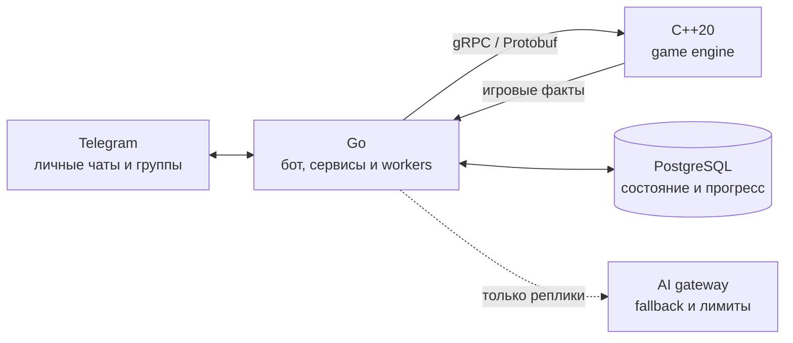

# CatForge Bot

**Социальная Telegram-игра с детерминированным C++20-движком и Go backend.**

[](https://github.com/Orurh/CatForge_bot/actions/workflows/ci.yml)

Игрок создаёт кота с характером, тренирует его, участвует в сражениях и событиях Двора вместе с друзьями. Игра работает непосредственно в личных сообщениях и группах Telegram — без отдельного Mini App.

**Главный архитектурный принцип:** C++-движок рассчитывает игровые результаты; Go управляет состоянием, API, событиями и Telegram UX. AI может формировать реплики и характер персонажей, **но не определяет победы, награды или прогресс**.

Проект находится в бета-разработке. [Действующие правила](docs/BETA_SPEC.md) · [План](PLAN.md) · [Технические решения и ограничения беты](docs/BETA_RUNBOOK.md)

## Что делает игрок

| Действие | Механика |
| --- | --- |
| 🐈 **Создаёт и тренирует кота** | Прогрессия, энергия, особенности персонажа, предметы |
| ⚔️ **Сражается с другими** | Очередь арены, детерминированный бой в C++-движке |
| 🏘️ **Участвует в жизни Двора** | Асинхронные события, отношения, недельные результаты |
| 💬 **Общается с котами** | AI-реплики, ответы на сообщения, лимиты и настройки приватности |

Подробные формулы, команды и игровые правила приведены ниже.

## Архитектура



| Компонент | Ответственность | Где смотреть |
| --- | --- | --- |
| **C++ engine** | Правила боя и прогрессии; вычисление исходов | [engine_cpp](engine_cpp) · [тесты движка](engine_cpp/tests) |
| **Go backend** | Сценарии игры, workers, Telegram, состояние | [internal](internal) · [cmd](cmd) |
| **Контракт Go ↔ C++** | Типизированные RPC и Protobuf | [api/gameengine/v1](api/gameengine/v1) |
| **Persistence** | PostgreSQL, миграции, контроль версий состояния | [internal/repo/postgres](internal/repo/postgres) · [migrations](migrations) |
| **Delivery & quality** | Сборка обоих компонентов, проверки и Docker-образы | [CI workflow](.github/workflows/ci.yml) · [CI script](scripts/ci.sh) |

**Быстрая проверка:** [запуск для разработки](#запуск-для-разработки) · [тесты](#проверки) · [инструкция беты](docs/BETA_RUNBOOK.md).

---
 
## Текущий MVP

Прогрессия: [Feline Progression v1](docs/FELINE_PROGRESSION.md). Когти, вес, хвост
и размах усов заменили публичные RPG-статы. Предметы открываются на Lv2, арена
на Lv3, дополнительные слоты — на Lv5 и Lv8.


- создание, профиль, переименование и удаление кота;
- одна команда `/train`, которая сразу проводит тренировку;
- энергия `0..100`, порог тренировки 50 и расход всего запаса;
  XP = 1.5 × расход × 75–125%, крит 5% добавляет ещё 100% базы;
- Yard и асинхронное событие «Машина с рыбой»;
- автоматическая очередь арены и детерминированный C++-бой по `/fight`;
- `/askcat`, reply-команда `/cat`, personality, humor и autospeak;
- ответ того же кота на обычный Telegram reply человека;
- редкие автономные реплики с лимитами Двора;
- `/week` как финал недельного цикла с TOP-10 и званиями;
- `/support` — разовая поддержка Stars: быстрые суммы или своя от 1 ⭐ (например, `/support 150`), без игровых преимуществ; [платежи и возвраты](docs/PAYMENTS.md).

`/fight` работает как toggle. Первый кот встаёт в очередь Двора, второй
автоматически начинает с ним бой, а повторная команда ждущего кота убирает его с
арены. Ожидание длится до 12 часов, но не дольше полуночи МСК. Каждый кот может участвовать только в
одной драке за любые 24 часа суммарно во всех Дворах. Из-за этого кнопка мгновенного реванша не
показывается.
Драки сохраняют победы, поражения, личный счёт, серию побед и relationships. За
участие кот получает 3% XP текущего уровня, победитель — ещё 2%; монет арена не
даёт.

После примечательной драки коты могут сами обменяться двумя короткими репликами.
Примечательными считаются первая встреча пары, неожиданная победа слабейшего кота,
результат на последних `1..5` единицах сил и milestone
rivalry. Для разговора оба владельца должны включить `/autospeak on`, а
администратор Двора — `/yardsettings auto on` и `/yardsettings banter on`.
Работает отдельный строгий лимит: не более одного разговора кот-к-коту на Двор
в сутки. Одиночные реакции событий имеют собственный лимит один раз в сутки;
общий предел по-прежнему задаётся `/yardsettings limit 0|1|2`.

Даже без драки два зарегистрированных кота с включённым autospeak могут
перепираться сами: worker чередует пары и учитывает friendship, rivalry и
respect. По умолчанию интервал — два часа, ночная пауза — 00:00–10:00 МСК.
После перезапуска worker ждёт полный интервал. Периодические разговоры имеют
собственное расписание; `limit 0`, отключение banter/auto и `/quiet` их запрещают.
После заметного события Двора два участника также могут обсудить его одним
сообщением; для этих разговоров действуют суточные квоты событийных реакций.

За пять минут до ночной паузы один активный кот прощается со всем чатом от своего
лица. По умолчанию это окно 23:55–00:00 МСК. Текст создаёт AI с учётом характера,
режима юмора и недавних реплик; в `bold` возможен подкол с запиканным матом.
Прощание имеет отдельный предел — одна попытка на Двор за ночь; `auto off`,
`banter off`, `limit 0`, `/quiet` и личный `autospeak off` его отключают.
Повторный запуск бота не повторяет прощание и не досылает его среди ночи.
Подробности: [речь котов](docs/CAT_SPEECH.md).

Если участник ответит обычным Telegram reply на ранее отправленную реплику
кота, может ответить именно этот кот. Бот помнит автора реплики 48 часов и
принимает только один ответ на каждое исходное сообщение. Механика уважает
`/autospeak off`, `/yardsettings auto off`, `/quiet` и часовые AI-лимиты. Privacy Mode
остаётся включённым: обычную переписку группы бот не читает.

События Двора запускает worker: он выбирает активные Дворы с двумя или более
котами, активными в этой группе за последние 7 дней. Первое событие приходит
через 24–48 часов после создания Двора, следующие — через 24–48 часов после
окончания предыдущего. `/event` показывает событие либо число активных котов
и время ближайшего автозапуска; сама команда событие не создаёт. Для ручного
теста администратору доступен `/eventstart`.
Три шаблона идут по кругу: «Рыбовоз», «Огромный пёс» и «Большая коробка».
У каждого свои названия ролей, тексты, сложность и полезные характеристики;
выборы скрыты до финала. Движок выдаёт один из четырёх исходов: провал,
частичный успех, успех или отличный успех. Один участник не может получить
полноценный успех. Цель не растёт вслед за прокачкой: знакомый Event становится
проще. Результат даёт общий `YardScore`, по 5/15/30/40 XP каждому участнику
в зависимости от tier, шанс предмета, MVP и изменения friendship, rivalry
и respect. 🐟/🦴/📎 остаются только деталями текста: личного пула и валюты нет.

В `/week` каждая категория даёт 0–7 очков, всего — до 21. Training считается
глобально для кота, включая личные тренировки. Arena и Yard относятся к текущему
Двору; участие в событиях нормализуется по возможностям конкретного кота с учётом
времени вступления. TOP-10 получает звания по текущим игровым результатам:
«Сигма-кот», «Пакет для битья», «Всё на мне, мяу», «Ты с какого лотка?»,
«Шкаф с усами», «Лапами объясню», «В каждой бочке кот», «Я чисто посмотреть».
У кота максимум одно звание; рекордные звания не передаются второму месту.

Expedition и Bestiary остаются выключенными. Предметы и экипировка появляются
в профиле после первой находки; большой старый `/collection` не возвращается. `/bind` и `/unbind`
больше не используются: результат действия остаётся в том чате, где оно было
запущено.

## Telegram-команды

В private chat доступно всё персональное управление:

```text
/start
/profile
/train
/name [имя]
/reset
/askcat вопрос
/cat
/autospeak on|off
/humor normal|bold
```

В группе остаются публичные игровые действия:

```text
/start       # нейтральная кнопка открыть private chat
/profile     # публичная read-only карточка без настроек
/train
/name имя   # переименовать кота прямо в группе
/askcat
/cat
/yard
/event
/fight
/week
```

Публичный `/profile` можно вызвать в каждой группе один раз в календарный день
для своего кота. В личке профиль не ограничен и содержит настройки; групповая
версия остаётся read-only.

Администраторы группы получают отдельный command scope:

```text
/yardsettings                       # статус и все команды управления
/yardsettings auto on|off           # автономные реплики
/yardsettings banter on|off         # перепалки кот-к-коту
/yardsettings fights on|off         # драки во Дворе
/yardsettings limit 0|1|2           # дневной лимит автореплик
/yardsettings humor normal|bold     # тон автореплик
/quiet 24h|off
```

`/yardsettings` и `/quiet` без аргументов показывают эту шпаргалку вместе с
текущими значениями.

Для ручной проверки в dev администратор может вызвать `/eventstart`. Команда намеренно не
показывается в Telegram command menu.

Экраны создания, юмора, автореплик и удаления кота никогда не рендерятся в группе: вместо них бот
публикует только нейтральную deep-link кнопку. Owner-bound callbacks дополнительно блокируют старые карточки.
В группе имя меняется одной командой: `/name@TryToGreat_bot НовоеИмя`. Выбор породы, humor, autospeak и
удаление кота остаются private-only.

## Процедурные реплики

Все игровые реплики, которые не генерирует LLM, вынесены из Go-кода в
[`internal/gamecontent/texts`](internal/gamecontent/texts):

- `training.json` — тренировки и реакции traits;
- `fight.json` — старт, результат, close fight, upset, лимиты и legacy-тексты реванша;
- `yard_events.json` — процедурные истории событий Двора;
- `ai_fallback.json` — тексты на случай отключённого/недоступного AI;
- `legacy_expedition.json` — замороженные Expedition narratives;
- `ui.json` — активные command descriptions, кнопки и короткие подсказки.

Чтобы расширить набор реплик, добавьте строку в массив нужного ключа. Можно
использовать шаблоны `{{.CatName}}`, `{{.WinnerName}}` и другие поля, уже
показанные в файлах. Каталог проверяет JSON, пустые варианты, дубликаты ключей
и синтаксис шаблонов:

```bash
go test ./internal/gamecontent
```

Контент встраивается в бинарник, поэтому после редактирования нужен rebuild.
Подробности находятся в
[`internal/gamecontent/texts/README.md`](internal/gamecontent/texts/README.md).

## Запуск для разработки

1. Скопируйте `.env.example` в `.env` и заполните Telegram token.
2. Запустите стек:

   ```bash
   docker compose -f docker-compose.dev.yml up -d --build
   ```

3. Проверьте сервисы:

   ```bash
   docker compose -f docker-compose.dev.yml ps
   curl -i http://127.0.0.1:8080/healthz
   docker compose -f docker-compose.dev.yml logs --since=2m bot game-engine
   ```

В dev используется Telegram long polling. Нормальный лог содержит
`telegram long polling enabled`. Production использует webhook с публичным
HTTPS URL и `TELEGRAM_WEBHOOK_SECRET`.

Остановка без удаления PostgreSQL volume:

```bash
docker compose -f docker-compose.dev.yml stop
```

Не добавляйте `-v` к `docker compose down`, если игровой прогресс нужно
сохранить.

## Проверки

```bash
go test -race ./...
go vet ./...

cmake -S engine_cpp -B engine_cpp/build -DCMAKE_BUILD_TYPE=Debug
cmake --build engine_cpp/build --parallel
ctest --test-dir engine_cpp/build --output-on-failure
```

Для ручной проверки баланса арены при запущенном C++-engine:

```bash
go run ./cmd/fight-balance-sim -battles 2000 -base-level 5 -diffs 0,3,5
```

После изменения Protobuf-контракта:

```bash
./scripts/generate_proto.sh
```

## Архитектура

- `cmd/bot` — запуск приложения и фоновых workers;
- `internal/app` — application services и GameEvent layer;
- `internal/domain` — игровые типы и чистые правила;
- `internal/gamecontent` — валидируемый каталог процедурных текстов;
- `internal/gameengine` — Go-контракт и gRPC-клиент;
- `engine_cpp` — авторитетный C++20 game engine;
- `api/gameengine/v1` — Protobuf-контракт Go/C++;
- `internal/ai` — provider-independent AI Gateway и safe fallback;
- `internal/repo/postgres` — PostgreSQL persistence;
- `internal/transport/telegram` — routing, callbacks, Telegram API и views;
- `migrations` — миграции Goose.

C++-движок определяет игровые факты. Go загружает состояние, вызывает движок,
сохраняет результат через optimistic `state_version`, публикует GameEvent и
формирует Telegram UX. AI получает только готовые факты и не может менять XP,
награды, outcome или relationships.

Текущие версии: `rules_version=14`, `content_version=5`. Активные события
content 2–4 движок умеет завершать после обновления. Go и C++ нужно выкладывать
вместе с миграцией Feline Progression.

Энергия восстанавливается по единице за 8 минут.

## AI provider

Временный режим беты через подписку Codex: [Codex bridge](docs/CODEX_BRIDGE.md).
Локальная dev-конфигурация подключает сокет; режим провайдера задаётся в `.env`.

По умолчанию работает procedural provider из редактируемого каталога. Для
OpenAI Responses API задайте:

```dotenv
AI_PROVIDER=openai
AI_API_KEY=...
AI_MODEL=gpt-4.1-nano
AI_BASE_URL=https://api.openai.com/v1
AI_TIMEOUT=5s
```

Для экономного старта беты выбран `gpt-4.1-nano`: без отдельного reasoning,
не более 180 выходных токенов на запрос. Входной текст пользователя ограничен
1000 символами; ручные запросы — 12 в час на пользователя и 40 на чат.
Это ограничение частоты, а не общий денежный лимит. Включайте `AI_PROVIDER=openai`
только после добавления `AI_API_KEY` в локальный `.env`.

При timeout или ошибке provider бот использует procedural fallback. Запросы
отправляются с `store: false`; API key и полный prompt не логируются. Privacy
Mode Telegram остаётся включённым: бот получает команды, callbacks, replies на
свои сообщения и явные игровые взаимодействия, но не читает весь обычный чат.
Для обычной тренировки AI не вызывается: генерация нужна только при
critical result, level-up или заметном rivalry-контексте.

Для теста AI-life есть view `analytics_ai_life_daily`: он считает
запрошенные ответы, автономные реплики, banter, ответы людей котам,
follow-up, fallback и все основные disable-сигналы.

/week ограничен одним запросом в 15 минут на всю группу. Интервалы других
команд и кнопок: [защита от повторов](docs/BETA_SPEC.md#защита-группы-от-повторных-команд).

## Подготовка беты

CI проверяет каждый push/PR; только push в `main` публикует проверенную пару Docker-образов.
Серверный таймер получает успешно проверенный main, делает бэкап и обновляет
бот вместе с движком. Первая настройка и восстановление при ошибках:
[обновления и GitHub Actions](docs/DEPLOYMENT.md).

Проверки, обновление, резервное копирование, восстановление и ручной сценарий:
[инструкция запуска беты](docs/BETA_RUNBOOK.md). Оставшиеся задачи — [PLAN](PLAN.md),
действующие правила — [BETA_SPEC](docs/BETA_SPEC.md),
D1/D3/D7/D14 и активация Дворов — [когортная аналитика](docs/BETA_ANALYTICS.md).

## Мониторинг

Prometheus + Grafana + Loki/Alloy + Alertmanager, готовый дашборд и правила тревог:
[запуск и эксплуатация мониторинга](docs/MONITORING.md).
Используйте `docker-compose.monitoring.yml` вместе с выбранным Compose-файлом бота.

Текущая формула тренировки и таймеры энергии: [Training v2](docs/TRAINING_V2.md).

## License

CatForge source code is source-available under the PolyForm Shield
License 1.0.0. See [LICENSE](LICENSE).

Use of the source code to provide products or services that compete
with CatForge is not permitted under that license.

CatForge branding is covered by the separate
[brand policy](ASSETS_LICENSE.md).

Separate commercial licenses may be available.
See [COMMERCIAL.md](COMMERCIAL.md).

### Самостоятельные разговоры котов

Каждый двор с двумя или более зарегистрированными котами получает короткий диалог
примерно раз в два часа. Пары меняются; учитываются характеры и отношения котов.
Темы — еда, поддержка, перепалки, тренировки и дворовой быт. Неактивность владельца
не исключает его кота, но `/autospeak off` исключает кота из разговоров.

Настройки окружения:

- `CAT_BANTER_INTERVAL=2h` — интервал (не менее минуты).
- `CAT_BANTER_TIMEZONE=Europe/Moscow` — часовой пояс.
- `CAT_BANTER_QUIET_START=0`, `CAT_BANTER_QUIET_END=10` — ночная тишина;
  одинаковые значения отключают ночной интервал.

После запуска первый разговор возможен только через полный интервал.
Пропущенные разговоры не воспроизводятся; ночные разговоры также не копятся.
Попытка разговора атомарно резервируется в PostgreSQL отдельно для каждого двора.
Самостоятельные диалоги имеют свой интервал и не расходуют дневную квоту реакций
на события. `/quiet`, отключение авто-сообщений, `/yardsettings banter off` и нулевой
дневной лимит подавляют их. Реакции на игровые действия сохраняют прежнее поведение.
Режим `bold`, автоматические реплики и разговоры включены по умолчанию у новых
дворов и котов. Миграция `202609110020` включает их также у всех существующих
дворов и котов и снимает ручную паузу `/quiet`; ночная тишина сохраняется.
Позже настройки можно изменить через `/yardsettings`, `/autospeak` и `/humor`.
Команда `/yard` показывает общее количество котов, не более пяти участников
и трёх связей; остальные участники продолжают участвовать в разговорах.

Правила речи, режим `bold` и память разговоров: [описание](docs/CAT_SPEECH.md).
